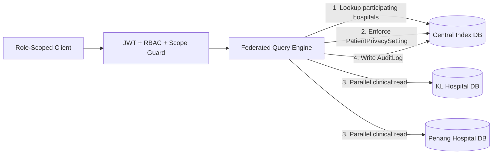

# 🏥 MedLink MY — National Medical Identity Network

A patient has visited two cities. Their earlier lab result is in George Town. Today’s appointment is in Kuala Lumpur. Which hospital database should the doctor ask? In **MedLink MY**, that question has its own federated data model. 🗺️

**MedLink MY** is a Malaysian healthcare interoperability platform prototype that uses a MyKad identity number to connect a patient’s clinical visits across **five regional hospital databases** via a **zero-clinical-text Central Pointer Hub**.

---

## 🗺️ Five Federated Hospital Nodes + One Central Hub

| Institution | City | Hospital ID | Environment Variable |
| --- | --- | --- | --- |
| 🏙️ Kuala Lumpur General Hospital | Kuala Lumpur | `hospital-kl` | `DATABASE_URL_HOSPITAL_KL` |
| 🌉 Penang General Hospital | George Town | `hospital-penang` | `DATABASE_URL_HOSPITAL_PENANG` |
| 🌳 Sultanah Aminah Hospital | Johor Bahru | `hospital-jb` | `DATABASE_URL_HOSPITAL_JB` |
| 🌺 Sarawak General Hospital | Kuching | `hospital-kuching` | `DATABASE_URL_HOSPITAL_KUCHING` |
| ⛰️ Queen Elizabeth Hospital | Kota Kinabalu | `hospital-kk` | `DATABASE_URL_HOSPITAL_KK` |

All five hospital nodes run identical clinical Prisma schemas (`backend/prisma/schema.hospital.prisma`), while the Central Hub (`backend/prisma/schema.central.prisma`) stores only **hospital metadata, MyKad-to-hospital index pointers (`PatientIndex`), authentication accounts (`User`), hospital-level patient consent rules (`PatientPrivacySetting`), and immutable security audit trails (`AuditLog`)**.

---

## 🔐 End-to-End Security, RBAC & Privacy Architecture



1. **Strict Object-Level Authorization (Zero IDOR)**:
   - **`patient`**: Restricted strictly to their own `icNumber` across `/api/central/query/:icNumber`, `/api/central/patient/:icNumber`, and `/api/hospitals/:hospitalId/patients/:icNumber/records`. Cross-patient lookups return `403` and record a denied `AuditLog` entry.
   - **`doctor` & `hospital_admin`**: Scoped to their authenticated `hospitalId` for local hospital stats, staff lists, encounter creation/updating, and hospital audit logs (`/api/central/audit-logs`). Cross-hospital clinical history is retrieved exclusively through the audited federated query workflow, and foreign hospital records are enforced `isReadOnly: true` on both backend and frontend.
   - **`central_admin`**: Authorized to govern the national pointer index, connected hospital health, and full network/emergency audit logs.
2. **Hospital-Level Patient Privacy Blacklist**:
   - When a patient blocks a hospital in `/patient/privacy`, doctors from that hospital are denied access across `/api/central/query/:icNumber`, `/api/central/patient/:icNumber`, and local patient record endpoints (`403` with `accessDenied: true`), with every blocked attempt logged to `AuditLog`.
   - Patients viewing their own records and `central_admin` index checks remain unaffected.
   - The frontend explicitly distinguishes **privacy-blocked (`403`)**, **partial hospital node failure (`status: 'error'`)**, **empty clinical history**, and **network errors**—never disguising failures or blocks as "no records".
3. **Full Clinical Write & Read-Only Integrity**:
   - Creating or updating an encounter (`POST /api/hospitals/:hospitalId/records` and `PUT /api/hospitals/:hospitalId/records/:recordId`) persists nested **`Prescription`** and **`LabReport`** rows in a single transaction, synchronizes patient demographics (name, DOB, gender, blood type, allergies, chronic conditions, emergency contact) on first visit at a new hospital, and updates the Central Pointer Index.
4. **Multi-Role MyKad Authentication & Hospital Verification**:
   - Users holding multiple roles under one MyKad (e.g., a doctor who is also a patient) can select their role at sign-in or switch roles seamlessly via `POST /api/auth/switch-role`.
   - Hospital staff complete second-step facility verification (`POST /api/auth/verify-hospital`) before accessing hospital clinical portals.
5. **Break-Glass Emergency Access**:
   - `GET /api/central/emergency/:icNumber` aggregates critical life-saving fields (blood type, allergies, chronic conditions, emergency contact, and active medications across all hospitals), enforces a per-IP+IC 60-second cooldown (`429`), returns `404` for unknown ICs, and writes high-priority `emergency_access` audit records.

---

## 🖥️ Federated Database vs. Workstation Session Tools

| Persistence Layer | Modules & Capabilities |
| --- | --- |
| **PostgreSQL Federated Persistence** (Central + 5 Hospital DBs) | Authentication & role switching, Cross-Hospital Patient Search & Timeline, New Encounter creation & local Encounter updates (with Prescriptions & Lab Reports), Patient Portal (Dashboard, Records, Hospital Privacy Controls, Access History), Emergency Break-Glass Lookup, Central & Hospital Audit Logs, National Patient Index, Hospital Doctor Directory (`StaffManagement` DB physicians). |
| **Session-Persisted Workstation Tools** (`sessionStorage` + real print/CSV/JSON export) | Outpatient Queue Management, Appointments, E-Prescription builder (also syncs to federated `MedicalRecord` when patient exists), Lab Orders, Radiology viewer, Medical Certificate (MC) generator, Inter-Hospital Referral drafts, Nursing Notes & Vitals chart, Subsidized Billing & Receipts, and Hospital Admin ward/department/inventory/financial operations boards. |

---

## 🚀 Setup, Build & Automated Verification

### 1. Local & Production Setup (PostgreSQL)

Configure six PostgreSQL databases in `backend/.env` (`JWT_SECRET`, `DATABASE_URL_CENTRAL`, `DATABASE_URL_HOSPITAL`, and `DATABASE_URL_HOSPITAL_KL` / `PENANG` / `JB` / `KUCHING` / `KK`):

| Terminal | Directory | Commands |
| --- | --- | --- |
| Backend API | `backend/` | `npm ci && npm run multi:setup && npm run dev` |
| Frontend App | `frontend/` | `npm ci && npm run dev` |

Open `http://localhost:5173` (Vite proxies `/api` to `http://localhost:3000`).

### 2. Offline Contract & Unit Test Suites

Both `backend/` and `frontend/` include self-contained `node:test` verification suites covering Express RBAC/IDOR/privacy/clinical persistence/emergency rate-limiting contracts, full-repo TypeScript/TSX compilation, `en`/`ms`/`zh` i18n parity, and frontend state/utility behavior:

```bash
cd backend && npm test
cd ../frontend && npm test
```
