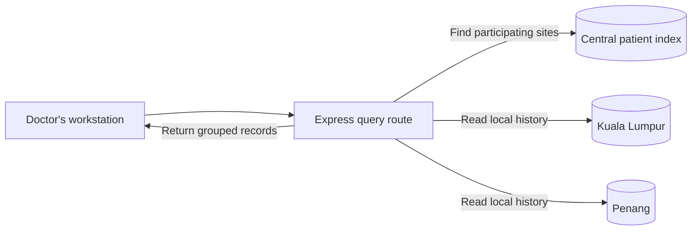

# 🏥 MedLink MY

A patient has visited two cities. Their earlier lab result is in George Town. Today’s appointment is in Kuala Lumpur. Which hospital database should the doctor ask? In this demo, that question has its own data model. 🗺️

**MedLink MY** is a Malaysian healthcare hackathon prototype that uses a MyKad identity number to connect a patient’s visits across **five demo hospitals**. The central hub keeps a directory of where to look. Each hospital holds its local clinical history. A timeline brings the relevant records together when someone opens a lookup.

## 🗺️ Five places on the map

| Demo hospital | City | The connection the registry selects |
| --- | --- | --- |
| 🏙️ Kuala Lumpur General Hospital | Kuala Lumpur | `DATABASE_URL_HOSPITAL_KL` |
| 🌉 Penang General Hospital | George Town | `DATABASE_URL_HOSPITAL_PENANG` |
| 🌳 Sultanah Aminah Hospital | Johor Bahru | `DATABASE_URL_HOSPITAL_JB` |
| 🌺 Sarawak General Hospital | Kuching | `DATABASE_URL_HOSPITAL_KUCHING` |
| ⛰️ Queen Elizabeth Hospital | Kota Kinabalu | `DATABASE_URL_HOSPITAL_KK` |

All five use the same clinical schema. The connection manager uses the hospital ID to find the database URL in the registry, creates a Prisma client on first use and reuses it for later requests. A separate client serves the central index. [Hospital registry](backend/src/config/index.ts) · [Prisma connection manager](backend/src/database/multi-db-manager.ts)

## 🔎 Follow one lookup

Imagine a seeded patient with an entry in Kuala Lumpur and an earlier visit in Penang. Here’s what the doctor’s timeline asks the application to do.

1. **Find the sites.** The hub reads the patient index and its hospital links. This example produces two destinations out of the five available.
2. **Check the requesting hospital.** The query takes account of the patient’s hospital-specific privacy settings before it reads those clinical histories.
3. **Read the sites in parallel.** Each result carries its hospital, record count, status and elapsed time. If one hospital read fails, the route records that site’s error while preserving the other results.
4. **Assemble the visit history.** The frontend can show where an encounter came from. The response marks records from another hospital read-only. The query also produces steps for the interface and an entry for the audit trail.

The reverse trip is worth reading too. When a doctor creates an encounter, the hospital route writes the local record, updates the central pointer for that site and records the action. The next lookup knows where to go. [Query implementation](backend/src/routes/central.ts) · [Encounter creation](backend/src/routes/hospital.ts) · [Timeline screen](frontend/src/pages/doctor/PatientTimeline.tsx)

🔍 A site reports zero records. Did it answer?

Look at the **status** beside the **record count**. A successful read can return an empty list. A failed site read also carries zero records, but its status and query step report an error. That distinction matters when a reader is trying to understand what a partial timeline actually contains. [Per-site results](backend/src/routes/central.ts)

## 🪪 Four views of the same visit

- **🩺 Doctor.** Search for a demo patient, inspect encounters from indexed hospitals and create a record in the local workspace. The hospital data model connects a visit to its clinician, prescriptions and lab reports. [Doctor workspace](frontend/src/pages/doctor/HospitalWorkstation.tsx) · [Clinical schema](backend/prisma/schema.hospital.prisma)
- **👤 Patient.** Revisit your own records, change hospital-specific access preferences and inspect the access history. A patient can see which facility a preference applies to before changing it. [Records](frontend/src/pages/patient/Records.tsx) · [Privacy controls](frontend/src/pages/patient/Privacy.tsx)
- **🏨 Hospital administrator.** Open a site dashboard, review activity and explore operations screens. Some workstation tools, including the bed-management display, illustrate workflows with local demo data. [Hospital admin](frontend/src/pages/admin/HospitalAdmin.tsx) · [Bed-management example](frontend/src/pages/admin/modules/BedManagement.tsx)
- **🗂️ Central administrator.** Browse the patient index, inspect hospital participation and review audit events. The emergency report displays the recorded actor, target, source, time and access result together. [Patient index](frontend/src/pages/admin/PatientIndex.tsx) · [Emergency report](frontend/src/components/EmergencyReportModal.tsx)

The login page offers seeded roles and animates the MyKad chip-reading sequence in the browser. The emergency view demonstrates a shorter summary with fields such as allergies and an emergency contact. These are prototype workflows for the supplied demo records. [Demo sign-in](frontend/src/pages/Login.tsx) · [Emergency view](frontend/src/pages/EmergencyAccess.tsx)

## 🗄️ What lives in which database?

| Central hub · one PostgreSQL database | Hospital sites · five PostgreSQL databases |
| --- | --- |
| `Hospital` identifies a participating site. | `Patient` and `Doctor` describe people within a site. |
| `PatientIndex` and `PatientIndexHospital` connect an identity to facilities that have records. | `MedicalRecord` holds the local encounter and links it to the clinician. |
| `User`, `PatientPrivacySetting` and `AuditLog` support sign-in, preferences and activity history. | `Prescription` and `LabReport` belong to the clinical side of the encounter. |

The backend is **TypeScript, Express and Prisma**. It generates separate clients for the central and clinical schemas. The **React and TypeScript** client uses **Vite**, **Zustand**, **Tailwind CSS** and shared hospital layouts. The doctor's dashboard hook lets the five themed workspaces reuse data-loading behavior. [Central schema](backend/prisma/schema.central.prisma) · [Hospital database adapter](backend/src/database/hospital-multi.ts) · [Shared dashboard hook](frontend/src/pages/doctor/dashboards/useDoctorDashboard.ts)

## 🧪 Set up the five demo hospitals

Prepare **six fresh PostgreSQL databases** and a Node.js/npm environment. Set `JWT_SECRET` and `DATABASE_URL_CENTRAL` in `backend/.env`, then set the five hospital URLs listed above. For Prisma CLI operations set `DATABASE_URL_HOSPITAL` to one of those demo hospital connections. The setup command pushes the schemas and replaces existing seed data in the configured databases. Use dedicated demo databases. [Schema setup script](backend/scripts/push-hospital-schemas.ts) · [Seed script](backend/prisma/seed-multi.ts)

| Terminal | Working directory | Commands |
| --- | --- | --- |
| API | `backend/` | `npm ci`, then `npm run multi:setup`, then `npm run dev` |
| Browser client | `frontend/` | `npm ci`, then `npm run dev` |

Open `http://localhost:5173`. Vite forwards `/api` to the backend on port **3000**. For a quick tour, pick a seeded doctor and inspect a patient timeline, then switch to the patient view and look at the access history. You’ll see the same lookup from both ends. 🔍 [Vite settings](frontend/vite.config.ts)
