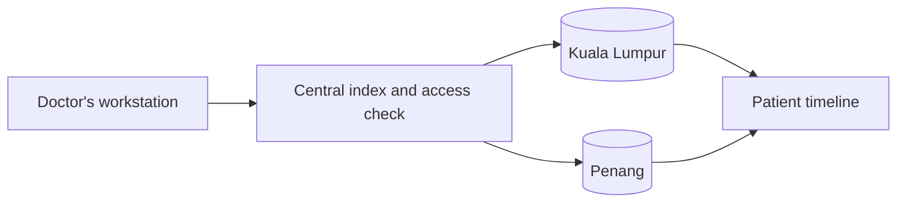

# MedLink MY

A doctor in Kuala Lumpur needs a lab result from a visit to Penang. The patient’s MyKad number tells the central hub where to look. To get the result, the application asks Penang.

Built for the Malaysia Healthcare Hackathon, **MedLink MY** models five demo hospitals. A central index records which facilities have seen each patient. Each hospital keeps its own clinical history in PostgreSQL.

## Follow one lookup

For a demo patient with records in two cities, the lookup takes this shape.

The Express query route checks whether the patient has blocked the requesting hospital. For an allowed lookup, it reads the indexed hospitals in parallel and returns records grouped by site, together with the query steps and elapsed time. That gives the interface a way to show where each part of the timeline came from. [Cross-hospital query](backend/src/routes/central.ts)

## What each person sees

- **Doctor.** Find a demo patient, read their timeline and create an encounter in the hospital workspace. The hospital schema connects that encounter to prescriptions and lab reports. [Clinical schema](backend/prisma/schema.hospital.prisma)
- **Patient.** Review your records, set hospital-specific privacy preferences and see who accessed your information. [Patient privacy screen](frontend/src/pages/patient/Privacy.tsx)
- **Administrator.** Open the hospital or central dashboard to inspect activity. Emergency access has a dedicated report showing the actor, target and time of a recorded event. [Emergency report](frontend/src/components/EmergencyReportModal.tsx)

## One hub, five clinical databases

The **React, TypeScript and Vite** client uses Zustand for session state. The **Express and Prisma** backend has two distinct schemas. The central schema holds users, patient-to-hospital links, privacy settings and audit entries. The hospital schema holds patients, clinicians and clinical history. The connection manager creates a Prisma client for each hospital on first use and reuses it for later requests. [Central schema](backend/prisma/schema.central.prisma) · [Connection manager](backend/src/database/multi-db-manager.ts)

## Run the six-database demo

Use Node.js and six fresh PostgreSQL databases. In `backend/.env`, set `JWT_SECRET` and `DATABASE_URL_CENTRAL`. Set the five hospital URLs using `DATABASE_URL_HOSPITAL_` followed by `KL`, `PENANG`, `JB`, `KUCHING` and `KK`. For Prisma CLI use, `DATABASE_URL_HOSPITAL` can point to one of the same demo hospital databases. [Hospital registry](backend/src/config/index.ts) · [Schema setup script](backend/scripts/push-hospital-schemas.ts)

1. From `backend/` run `npm ci`, `npm run multi:setup`, then `npm run dev`. The setup command pushes the schemas and replaces existing data in the configured databases with demo records.
2. From `frontend/` in a second terminal run `npm ci` and `npm run dev`. Open `http://localhost:5173`. Vite forwards `/api` requests to the backend on port `3000`. [Demo seed](backend/prisma/seed-multi.ts) · [Vite configuration](frontend/vite.config.ts)
